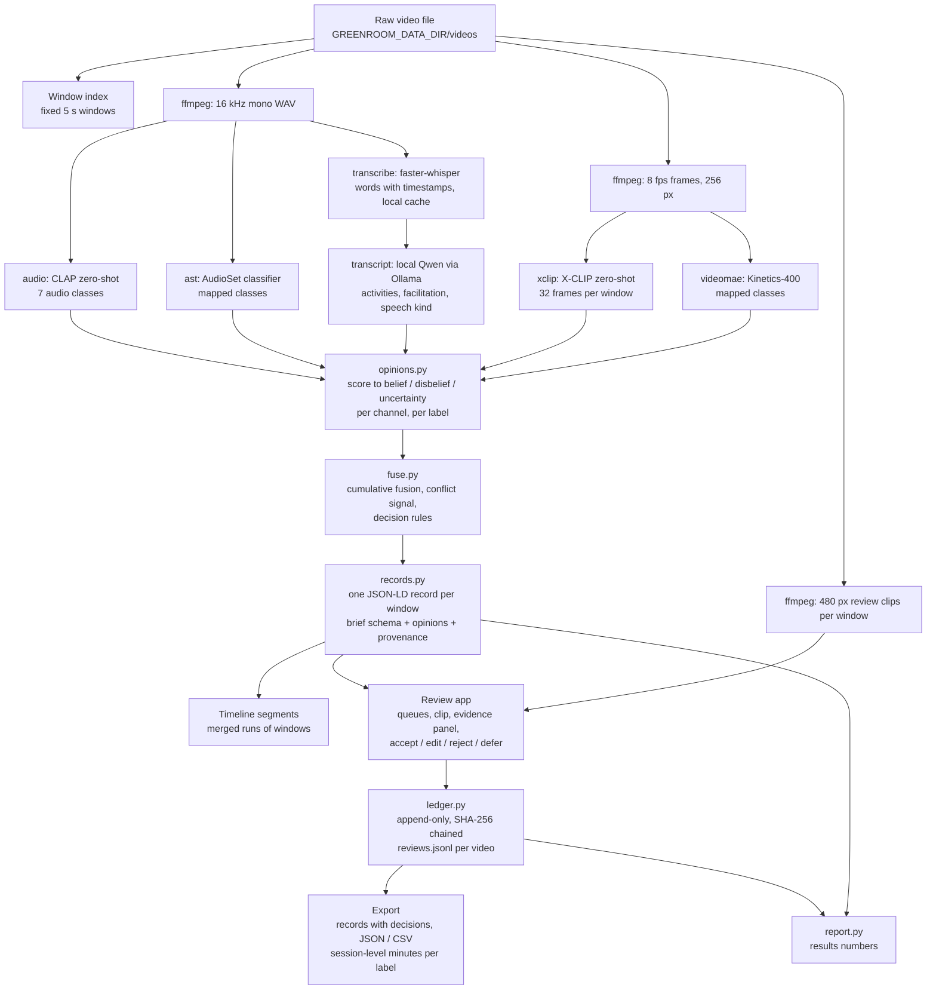

# greenroom architecture and workflow

How data moves from a raw recording to a staff member's screen and back out as a reviewed record. Everything runs on one machine; nothing leaves it.

## Stages, in order

1. **Index.** `greenroom windows --subclips` probes every video, cuts it into consecutive 5-second windows (window ids `<video>:<index>`), and renders a low-resolution clip per window for review. Windows are the unit for scores, labels, decisions and metrics; nothing downstream depends on scene detection.
2. **Ingest.** The pipeline extracts a 16 kHz mono audio track and samples frames at 8 fps (256 px) into a cache under the data directory. No crops of any kind are written.
3. **Evidence channels.** Each channel scores every window for the taxonomy labels it can observe and reports an input-quality factor (signal above the noise floor, frame brightness, word count):
   - `audio`: CLAP zero-shot over seven audio classes (singing, rap, spoken word, speech, applause, music, silence); class mass is summed into the labels it supports.
   - `ast`: an AudioSet classifier whose singing, rapping, applause and silence classes map to labels; speech, music and instrument classes are context only.
   - `xclip`: X-CLIP scores the window's frames against three phrasings per label; singing and rap receive equal visual support because a camera cannot tell them apart.
   - `videomae`: a Kinetics-400 classifier whose dance, singing, recording-music, applause, drawing, painting, writing, instrument and sewing classes map to labels.
   - `transcript`: faster-whisper transcribes locally (cached per video); a local instruct model reads each window's words with 20 s of context and returns supported activities, ruled-out labels, a facilitation flag and the kind of speech. Transcript text stays in the cache and never enters records or metadata.
4. **Opinions.** Each channel's score for a label becomes a Subjective Logic opinion (belief, disbelief, uncertainty, base rate). Positive and negative evidence carry separate weights per channel, so a Kinetics model's silence on "songwriting" is uncertainty, not disbelief; the softmax channels are normalized against their own leader and against chance. A channel that saw nothing (silent window, dark frames, no words) contributes a vacuous opinion.
5. **Fusion and decisions.** Opinions are fused per label with cumulative fusion; a conflict mass is computed alongside. The primary label is the highest projected probability; secondaries are activities above a threshold; a window goes to the review queue when the primary is uncertain, when channels conflict, or when nothing reaches the confidence floor; it is marked mixed when a second activity is clearly present as well.
6. **Records.** One JSON-LD record per window in the organizers' schema (video id, start and end, primary and secondary labels, facilitation flag, observable indicators, staff observation, expression suggestion, confidence, origin, reviewer decision, guideline version, note, review date) plus the fused and per-channel opinions, the conflict score, the review status with its reasons, and provenance (pipeline version, git commit, profile, model ids). Consecutive windows with the same primary label are merged into timeline segments.
7. **Review.** The Streamlit app lists windows by queue (review required, mixed, confident), plays the clip with optional context, shows the suggestion with its belief, disbelief, uncertainty and conflict, the per-channel evidence behind it, the speech line, and the four decisions. Every decision is appended to a hash-chained ledger per video with the reviewer, the model's original suggestion, the final labels, the note and the time spent. `greenroom verify` recomputes the chain.
8. **Out.** Records merged with decisions export as JSON and CSV; the session summary gives minutes per label and decision counts; `greenroom report` turns records, ledgers and run metadata into the results numbers (file-name agreement, staff agreement, inter-channel diagnostics, throughput, energy).

## Profiles

`profiles/rtx4090.yaml` is the development profile; `profiles/t4.yaml` keeps the same pipeline with smaller models (8-frame X-CLIP, distil-whisper, 3B cue model, no AST) for a T4-class GPU. Both measure wall time per stage and GPU energy through NVML.

## Privacy by construction

No face embeddings, voiceprints or identity structures are written anywhere; the person detector counts and discards; transcripts stay local; the cue model refuses cloud-routed tags; the data directory lives outside the repository and the code refuses to run otherwise. See docs/DATA_GOVERNANCE.md.
