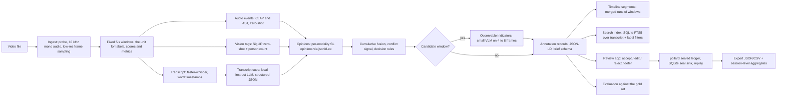

# greenroom: architecture plan and labor split

AI4Good Hackathon 2026, Problem Case 1 (The Performance Academy Video Intelligence Challenge), Track A (Automated AI Video Indexing and Review Support).

Working name: greenroom (the room where performers wait before they go on stage; here, where AI suggestions wait for staff review before they count).

This file is the single source of truth for the build. Decisions are numbered (D1, D2, ...) and are either approved or pending. Nothing is built against a pending decision except where a default is stated.

Status of this document: v0.2, Saturday midday, after inspecting the data and the existing team repository. Facts about the data come from the organizers' brief and from the files on disk; nothing here is a measured result.

---

## 1. What we are building, in one paragraph

A local, open-source pipeline that takes one TPA recording, cuts it into fixed 5-second windows, scores each window for performing-arts and creative-practice activities using three independent evidence channels (audio events, transcript cues, visual tags), fuses those channels into Subjective Logic opinions so that every label carries belief, disbelief and uncertainty rather than a bare probability, routes uncertain or conflicting windows to a "staff review required" queue, merges runs of windows into timeline segments, writes one annotation record per window in the exact schema the brief asks for, and presents the records in a review app where staff accept, edit, reject or defer each suggestion. Every review decision is sealed into a pollard ledger so the audit trail is tamper-evident and replayable. The system never identifies individuals, never stores face crops or embeddings, and never asserts an emotional state; the five expression labels exist only as unverified, text-derived suggestions that staff may accept or discard.

## 2. How this maps to the rubric and the deliverables

| Rubric item (weight) | Where it is earned |
|---|---|
| Model Performance (40%) | Section 8: a hand-labeled gold set built by the team, per-label precision/recall/F1, confusion matrix, calibration (ECE, Brier), risk-coverage curve for the abstention flag, modality ablations, honest baselines, cluster-bootstrap CIs, throughput and energy per hour of video |
| Solution Approach (40%) | SL fusion with explicit uncertainty and conflict (originality), T4-sized profile and zero-dependency governance library (feasibility), staff-time measured and session-level impact aggregates (operational impact), privacy-by-construction (no identity, no affect from faces) |
| Presentation (20%) | Section 11: slide plan, demo script, stakeholder impact, next steps |

| Expected deliverable (brief) | Artifact in this repo |
|---|---|
| Problem case and track, team, contacts | README.md header |
| Runnable code and environment | src/, profiles/, requirements.lock, README quickstart |
| Architecture and workflow diagram | docs/ARCHITECTURE.md (Mermaid, Section 4 below) |
| Structured output file (time-stamped, multi-label) | samples/annotations.sample.jsonld and .csv, generated from team-recorded footage only (D9) |
| Review and annotation interface (accept, edit, reject, defer) | app/review_app.py |
| Model/System card | docs/SYSTEM_CARD.md |
| Data-governance note | docs/DATA_GOVERNANCE.md |
| Demonstration (end-to-end) | docs/DEMO_SCRIPT.md plus a recorded run on team footage |

## 3. Constraints and facts we build against

From the brief:

- Local, open-source, Hugging Face models. No provided file or derived content ever leaves the laptop. HF private endpoints are allowed under the $20 credit only with everything set to Private (used, if at all, only for the T4 timing measurement, D11).
- No facial recognition, no face embeddings, no identity registries. We also do not do face-based affect; see D7.
- No clinical or psychological claims. Expression labels are unverified suggestions only.
- Target hardware for the deployable profile: a single T4-class GPU (16 GB). Development runs on the RTX 4090 laptop (16 GB VRAM, 64 GB RAM).
- Zero public exposure: no youth footage, frames, audio, transcripts or participant-level annotations in any repo, slide, DevPost page or recording. See D9.
- Post-event privacy freeze: nothing from the data is reused outside the hackathon without written permission.

From the data on disk (E:\data\code\claudecode\ai4goodhackathonjax\data\videos):

- 8 of the 12 provided files are present: the intro, the two songwriting clips (deshaun, reese) and the five TikTok promos (painting, dance, rap, singing, boots). The four multi-gigabyte files (final video 1.67 GB, Live Camp2 12.01 GB, camp2 montage 2.05 GB, final show camp1 8.11 GB) were not pulled. Durations and window counts come from `python -m greenroom windows` and are recorded in the window index, not estimated here.
- Consequence: the provided footage is a set of short, mostly edited clips, not hours of raw workshop video. The long-form behavior of the system (dead time, transitions, hour-scale throughput) therefore has to be tested on footage we record ourselves (D13), and the TPA gold set is a census of every window rather than a sample (D12).

From the existing team repository (github.com/kushulreddy39/performers-academy-video-analysis, cloned next to this folder):

- Current branch content: a CPU CLIP ViT-B/32 baseline over 10-second windows, a Streamlit review prototype with the four decisions, JSON/CSV outputs and an append-only audit JSONL. Scores are raw image-text similarities; no audio, no transcript, no calibration, no evaluation.
- Its README states that `main` holds an older face-detection, FaceNet identity-clustering and facial-expression exploration, and docs/KNOWN_LIMITATIONS.md describes face crops, identity clusters and expression classification. The brief says facial recognition and identity registries lead to immediate disqualification. That code and its history cannot be part of what judges open. See D14.
- What we take from it: the idea of overlapping prompt phrasings per activity (we use prompt ensembles per label) and the four-decision review loop. Nothing else is reused.

## 4. Architecture



### 4.1 Ingest (src/greenroom/media.py)

- ffprobe (or the ffmpeg banner when ffprobe is absent) for duration and frame rate; ffmpeg to extract a 16 kHz mono WAV and to sample frames at 1 fps, long side 384 px, into a derived cache under the data directory (never under the repo).
- Frame sampling is the only visual artifact. No crops of any kind are written.
- Everything derived lives in GREENROOM_DATA_DIR/derived/ and is removed by scripts/purge_derived.py.

### 4.2 Windows (src/greenroom/windows.py)

- Every video is cut into consecutive non-overlapping 5-second windows; a trailing remainder shorter than 2 s is merged into the previous window. Window ids are `<video_id>:<index>`.
- Windows are the unit for gold labels, model scores and every metric (D12). Timeline segments are merged runs of windows with the same primary label (`merge_runs`). Scene-cut detection, if added later, only refines segment boundaries for display and never changes the evaluation unit.
- Gold labeling therefore depends only on the window index and the review subclips, not on any model, and can start the moment `python -m greenroom windows --subclips` has run.

### 4.3 Audio events (src/greenroom/audio_events.py)

- CLAP (laion/larger_clap_music_and_speech, with laion/clap-htsat-unfused as fallback) scored zero-shot against text prompts per activity ("a person singing", "rap vocals over a beat", "spoken word poetry performed into a microphone", "applause from an audience", "people talking in a room", "instrumental music", "silence or room noise").
- AST (MIT/ast-finetuned-audioset-10-10-0.4593) as a second audio channel using its AudioSet classes (Singing, Rapping, Speech, Applause, Music, Crowd, Silence); rtx4090 profile only.
- Both are computed on 10 s analysis windows with a 5 s hop and assigned to the 5 s window they are centered on. The ablation (Section 8) tells us whether one channel is enough.

### 4.4 Transcript (src/greenroom/transcribe.py)

- faster-whisper. rtx4090 profile: large-v3. t4 profile: distil-large-v3 (English). VAD filter on; windows whose no-speech probability is above threshold are left without transcript rather than filled with hallucinated text over music.
- Word timestamps are kept so transcript text aligns to windows.
- No speaker diarization and no speaker embeddings (a voiceprint is a biometric; the brief lists it among the things that must never be exposed and we do not create one). Participant versus facilitator is handled from the words, not the voice (4.5).

### 4.5 Transcript cues (src/greenroom/transcript_cues.py)

- A local instruct LLM reads the window's transcript (plus 20 s of context either side) and returns strict JSON: activities present (taxonomy, Section 5), a facilitation flag (instructional or directive speech such as "from the top", "everyone stand up", "try that again" is facilitation; first-person creative content is participant activity), a short rationale, and a self-reported confidence.
- Self-reported LLM confidence is poorly calibrated; it enters the fusion with a lower evidence weight (Section 6) and the ablation measures what it adds.
- Served by Ollama. Model: qwen2.5:7b-instruct on the rtx4090 profile, qwen2.5:3b-instruct on the t4 profile. The client refuses any model tag that is cloud-routed (D17). If a Qwen3-class model is used, thinking is disabled so the token budget is not consumed by reasoning traces.

### 4.6 Vision tags (src/greenroom/vision_tags.py)

- SigLIP zero-shot (google/siglip-so400m-patch14-384 on the rtx4090 profile; google/siglip-base-patch16-224 on the t4 profile; SigLIP 2 equivalents if the installed transformers supports them) with a prompt ensemble per activity (3 to 5 phrasings each, e.g. "teenagers dancing on a stage", "a person painting at an easel", "a person singing into a microphone", "a fashion runway walk", "people recording a podcast at a table with microphones", "a camera operator filming a scene").
- Per window: the frames whose centers fall inside the window (4 on the rtx4090 profile, 2 on t4), pooled by mean per label.
- Person count per frame from a detector on HF (facebook/detr-resnet-50), used for two things only: skipping empty-room windows and reporting participation volume at session level. Boxes are counted and discarded; nothing is cropped or stored.

### 4.7 Observable indicators (src/greenroom/indicators.py)

- For candidate windows only (Section 6.3), a small VLM (Qwen/Qwen2.5-VL-3B-Instruct on the t4 profile, 7B on the rtx4090 profile) sees 4 to 8 frames and the transcript snippet and writes a one-sentence description of observable facts: position (on stage, at a table, at an easel), object in hand (microphone, brush, camera, fabric), audience-facing or not, group or solo, movement.
- The prompt forbids emotional or mental-state language; a post-filter removes the affect blocklist in taxonomy.py and logs every removal. This text fills the record field "observable performance or participation indicators".

### 4.8 Expression suggestions (Target 2 of the brief)

- The brief asks Track A systems to propose generalized expression labels (Confident, Upset, Positive, Neutral, Negative) as unverified suggestions. We derive them from transcript text only (the local LLM maps the words of the window to one of the five, or to "no suggestion" when there is no speech). Nothing is derived from faces or body pose (D7).
- In the review app these suggestions are collapsed behind a "show unverified AI suggestion" toggle, carry the status ai_suggested_unverified, and never enter any aggregate unless a staff member accepts or edits them.

### 4.9 Records (src/greenroom/records.py)

One record per window, JSON-LD with a small greenroom context plus the jsonld-ex opinion carrier. Fields, in the brief's order, then our additions:

- video_id
- start_s, end_s
- primary_activity, secondary_activities[]
- facilitation_flag (participant activity vs staff facilitation or instruction)
- observable_indicators (text, from 4.7; empty for non-candidates)
- staff_contextual_observation (optional, staff-entered)
- expression_suggestion (optional, status ai_suggested_unverified)
- confidence (projected probability of the primary label; kept for the brief's "model confidence score")
- opinion_primary {belief, disbelief, uncertainty, base_rate}
- opinions_by_label {label: {b, d, u, a}} and opinions_by_modality {audio, vision, transcript}
- conflict_score
- review_status: ai_suggested | staff_review_required | mixed_activity
- origin: ai_generated | staff_generated
- reviewer_decision: accepted | edited | rejected | deferred | pending
- guideline_version (e.g. "1.0")
- reviewer_note (optional)
- review_date
- provenance: pipeline_version, git_sha, profile (rtx4090 | t4), model_ids[], seal_node_id

CSV export flattens the same record; list fields are pipe-separated.

### 4.10 Review app (app/review_app.py) and gold app (app/gold_app.py)

- Streamlit (D15), matching the existing team prototype so teammates can read it. The gold app exists now; the review app is built in Phase 3 on the same window and subclip machinery.
- Review app: left, the window subclip (or the merged segment) and transcript snippet; right, proposed labels with belief/disbelief/uncertainty bars, the facilitation flag, the observable-indicators sentence, the collapsed expression suggestion, and four buttons: Accept, Edit (opens the label editor), Reject, Defer, plus a free-text reviewer note. Reviewer name from a dropdown (no accounts in the prototype; access is the laptop login).
- Two queues: "review required" (uncertain, conflicting, mixed) and "confident candidates", plus search (4.11).
- Gold app: the same subclip playback with no model output anywhere on screen, a form with primary, secondary, facilitation, uncertain and note, "save and next unlabeled", per-annotator JSONL under the data directory. It also records seconds spent per window, which feeds the staff-time comparison (8.3).
- Aggregates tab (review app): per video or session, minutes per activity, number of distinct activities, candidate moments found, reviewed, accepted; median person count. No per-individual statistics exist anywhere, by construction.

### 4.11 Search (src/greenroom/search.py)

- SQLite FTS5 over transcript windows plus label and status filters gives the "searchable timeline". Optional: a small text embedding model (BAAI/bge-small-en-v1.5) over transcript windows for semantic queries such as "someone shares an original song". Optional means built after Section 8 is running, not before.

### 4.12 Ledger (src/greenroom/ledger.py)

- pollard. Every review decision (and every pipeline run) becomes a node in the execution tree; decisions are sealed with pollard.seal into an SQLiteSealSink custody log, following the pattern already proven in gatehouse (ledger/seal.py: rolling SHA-256 seal, verify function, fail-soft on an unwritable log). A `greenroom verify` command replays and checks the chain.
- The exact calls are confirmed against the installed pollard version before coding; install from PyPI and pin.
- Value to the judges: a Track B-grade audit trail delivered inside a Track A submission, from a zero-dependency library already on PyPI.

## 5. Label taxonomy (guideline v1.0, docs/ANNOTATION_GUIDELINE.md, src/greenroom/taxonomy.py)

Activity labels (multi-label, window level):

1. singing_vocal_performance
2. songwriting
3. lyricism_spoken_word_rap
4. dance
5. acting_theater
6. film_media_production (camera operation, interview recording, editing)
7. recording_arts_audio_production
8. podcast_production
9. visual_arts (painting, drawing, design concept work)
10. fashion_design
11. modeling_runway
12. group_performance_or_showcase (a full-ensemble number; co-occurs with 1 to 5)

Non-activity window classes (exactly one of these may be primary when no activity is present):

13. instruction_facilitation (also available as a flag alongside any activity)
14. audience_applause_transition
15. setup_idle_empty

Rules: one primary; zero or more secondary; "uncertain" is a legitimate annotator choice and is recorded as such; a window with two activities of comparable salience is labeled with both and the system marks it mixed. The guideline carries a version string that is written into every record.

## 6. Uncertainty, fusion and decision rules

### 6.1 From model scores to opinions

For each modality m and label l, the model gives a score p in [0, 1] (sigmoid or softmax-normalized zero-shot similarity, or the LLM's mapped confidence). We convert it to a binomial opinion with evidence weight E_m scaled by an input-quality factor q_m in [0, 1]:

- r = E_m * q_m * p (positive evidence), s = E_m * q_m * (1 - p) (negative evidence), prior weight W = 2
- b = r / (r + s + W), d = s / (r + s + W), u = W / (r + s + W), a = base rate of label l
- Projected probability P = b + a * u

q_m encodes whether the modality could see anything: audio q from the fraction of the window above the noise floor and the no-speech probability; vision q from the fraction of sampled frames containing at least one person; transcript q from word count against a floor. A silent window therefore yields a vacuous audio opinion (u near 1) instead of a confident "no singing". This is the mechanism behind the brief's "explicit uncertain option" and it is the thing a bare classifier cannot express.

E_m per modality and the base rates are fitted on the calibration split (Section 8.2), never on the test split.

### 6.2 Fusion and conflict

- Cumulative fusion of the three modality opinions per label (operators from jsonld-ex, as used in SL-RAG). Modalities observe the same window through independent sensors, which is the setting cumulative fusion assumes.
- Conflict score per label from the SL-RAG conflict signal (computed in parallel, not folded into the fused opinion).

### 6.3 Decision rules

- primary = argmax over labels of P_l; secondary = labels with P_l >= tau_p other than the primary
- review_status = staff_review_required if u_primary >= tau_u or conflict >= tau_c; mixed_activity if the top-two margin in P is below tau_m; otherwise ai_suggested
- candidate = primary is an activity label (1 to 12)
- All tau values are chosen on the calibration split by maximizing selective accuracy at a target coverage; reported in the system card with the split sizes. The placeholder values in profiles/*.yaml are overwritten by the fit.

### 6.4 Baselines for the ablation (no strawmen)

- Each modality alone (audio, vision, transcript).
- Fusion by mean of probabilities and by max of probabilities, with the same thresholds re-fitted on the calibration split.
- Uncertainty baseline: 1 minus max probability as the abstention score, compared with fused u on the same risk-coverage axes.
- If SL fusion does not beat the mean-of-probabilities baseline on the gold set, the slide says so and we present the uncertainty handling, not accuracy, as the contribution.

## 7. Compute profiles (profiles/rtx4090.yaml, profiles/t4.yaml)

| Component | rtx4090 profile (development) | t4 profile (deployable) |
|---|---|---|
| ASR | faster-whisper large-v3, float16 | distil-large-v3, int8_float16 |
| Audio events | CLAP + AST | CLAP only |
| Vision tags | SigLIP so400m-384, 4 frames per window | SigLIP base-224, 2 frames per window |
| Person count | DETR at 1 fps | DETR at 0.5 fps |
| Transcript LLM | qwen2.5:7b-instruct (Ollama) | qwen2.5:3b-instruct (Ollama) |
| VLM | Qwen2.5-VL-7B-Instruct on candidates | Qwen2.5-VL-3B-Instruct on candidates |

Stages run one after another and release the GPU between them, because a laptop 4090 has 16 GB. Throughput (minutes of video processed per minute of wall clock) and GPU energy (NVML, joules per hour of video) are logged per stage for every run. The t4 profile is measured for real only if D11 is approved (private HF endpoint on the credit); otherwise it is run on the 4090 with the t4 model set and reported as such, with no claim about T4 timing.

## 8. Evaluation plan (the 40%)

### 8.1 Gold set

- Unit: the 5-second window (D12). Metrics are computed on the system's own units and gold labels share them exactly.
- TPA footage: a census. Two annotators label every window of all 8 files independently in gold mode (no model output visible) using guideline v1.0; disagreements are adjudicated jointly by the two annotators; the pipeline author takes no part in labeling or adjudication. Inter-annotator agreement is reported (Cohen's kappa on the primary label, per-label kappa for secondary labels and the facilitation flag).
- Calibration split: a fixed, seeded 20% of TPA windows stratified by video, used for evidence weights, base rates and thresholds. The remaining 80% is the test split. The split is written to the data directory before any threshold is chosen.
- Team footage (D13): 45 to 60 minutes of continuous footage recorded by the team. Two annotators label a seeded stratified sample of 200 windows (strata: the pipeline's preliminary primary label and the person-count bucket, so dead time and transitions are represented) plus every window the pipeline marks review-required. Reported separately from the TPA numbers, never pooled.
- Because adjacent windows of one clip are correlated, every confidence interval is a cluster bootstrap by video (1000 resamples), not an i.i.d. bootstrap over windows.

### 8.2 Metrics

- Multi-label activity: per-label precision, recall, F1; micro and macro F1; Hamming loss; subset accuracy.
- Primary label: accuracy and a confusion matrix (the slide the template literally asks for).
- Facilitation flag: precision, recall, F1.
- Calibration: ECE (adaptive binning), Brier score, reliability diagram on P of the primary label.
- Abstention: risk-coverage curve and AURC using fused u as the score, versus 1 minus max probability; selective accuracy at the chosen operating point.
- Conflict: fraction of staff_review_required windows where annotators also disagreed or chose uncertain (does the flag land where humans hesitate).
- Ablations as in 6.4.
- Cluster-bootstrap 95% confidence intervals on every headline number, using the SL-RAG metrics implementation.
- Efficiency: throughput and energy per hour of video per profile, per stage.

### 8.3 Staff-time measurement

- The gold app already records seconds spent per window without suggestions. In Phase 4 the two teammates review 60 windows in the review app with suggestions shown (30 confident candidates, 30 review-required). Median seconds per decision is reported for each condition. Small, but it is a measured number about the thing TPA cares about (time), presented as a pilot, not a study.

## 9. Governance and privacy, by construction

- GREENROOM_DATA_DIR points outside the repo and config.data_dir() refuses a data directory inside the repo; .gitignore excludes data, derived caches, databases, media of any kind as a second fence.
- No face crops, embeddings, voiceprints or identity structures exist anywhere in the pipeline. Person detection counts boxes and discards them.
- Transcripts are personal narrative and stay local; they are never exported in the DevPost sample. Samples for public artifacts come from team-recorded footage of consenting adults (D9).
- The LLM client refuses cloud-routed Ollama models (D17), so a misconfiguration cannot send transcript text off the laptop.
- Review decisions are sealed (pollard); `greenroom verify` detects any edit to the log.
- Retention: scripts/purge_derived.py removes all derived artifacts; the data-governance note specifies that the team deletes its copies after the handover the organizers request, and that records are keyed by video_id so a consent withdrawal removes everything for that recording. The hashrope erasure-compatible redaction design is described as future work in the note, not built.
- The submission repository is private during the event; organizers and judges are added as collaborators for the DevPost link (D14).

## 10. Labor split

Muntaser (pipeline owner)
- Sections 4.1 to 4.9, 4.11, 4.12, 6, 7, 8.2 metrics code, architecture diagram, system card technical sections, the Model Performance slides.

Teammate A (annotation lead)
- Owns guideline v1.0 wording (with Muntaser's taxonomy), labels every TPA window in the gold app, adjudicates with Teammate B, runs the IAA script, drafts the data-governance note from the outline in Section 9, builds the Motivation and Implications slides.

Teammate B (review and demo lead)
- Second gold annotator; runs the staff-time pilot (8.3); writes the demo script and records the public demo on team footage; writes the README quickstart by following it on a clean machine; owns the DevPost page text and the slide deck assembly in the organizers' template.

Shared, and first in time (D13)
- The two teammates record 45 to 60 minutes of continuous footage in the venue: a mock workshop with a song, a spoken piece, a short dance, someone giving instructions and feedback, a conversation at a table, and deliberate setup and idle stretches. Phone camera on a tripod, one continuous take, no cuts. This is the only footage that appears in any public artifact, it is the long-form test input, and it is the demo input.

## 11. Presentation plan (template slides)

1. Motivation and problem: TPA's archive, the hour-long files, the staff time, the ethical line (no diagnosis).
2. Solution summary: the one-paragraph description from Section 1 as three bullets; the architecture figure.
3. Data: the 8 files and their durations from the index, how windows were made, the gold set and IAA numbers, the team footage and why it exists.
4. Method: three evidence channels, opinions with uncertainty (one picture of b/d/u bars), fusion, the review loop and the sealed ledger. Explain every technical term in one line; two judges are not ML people.
5. Results: confusion matrix, per-label F1 with CIs, reliability diagram, risk-coverage curve, ablation table, throughput and energy per hour of video per profile, seconds per staff decision.
6. Implications and next steps: staff-defined labels, deployment on TPA's own hardware or a T4, consent-aware erasure (hashrope), what would make the labels better (TPA-reviewed data as training signal), risks.

Demo (inside slide 2 or 5): run the pipeline on the team footage live or from the recording, open the review app on the real data (laptop screen only, not in the deck), accept one, edit one, defer one, run `greenroom verify`, export.

## 12. Build sequence

Order of operations, not a schedule. Each phase ends with something that runs end to end.

- Phase 0 (done in this folder): package scaffold, environment check, profiles, data path config with the in-repo guard, window index and review subclips, guideline v1.0, gold labeling app, unit tests.
- Phase 1: skinny path on one short file: audio extraction, audio events only, opinions, records, merged segments, export. Then the full index and subclips for the team footage as soon as it exists.
- Phase 2: transcript, vision, transcript cues, fusion, decision rules; full run on all 8 files with the rtx4090 profile.
- Phase 3: pollard ledger and verify, search, review app, aggregates tab, VLM indicators on candidates, expression suggestions behind the toggle.
- Phase 4: evaluation: gold set frozen, calibration split fitted, metrics, ablations, figures, staff-time pilot, t4 profile run.
- Phase 5: system card, governance note, architecture doc, README, demo recording, slides, DevPost.

## 13. Decision log

- D1 (approved): Problem Case 1, Track A.
- D2 (default, in effect): working name greenroom for the package and the new repository.
- D3 (superseded by D12): segment bounds.
- D4 (default, in effect): CLAP primary audio channel, AST second channel on the rtx4090 profile only.
- D5 (default, in effect): SigLIP so400m-384 on rtx4090, base-224 on t4; DETR for person counts.
- D6 (resolved): transcript LLM served by Ollama; qwen2.5:7b-instruct must be pulled, since only cloud-routed models are present on the machine.
- D7 (recommended, pending): expression suggestions are transcript-derived only, shown behind a toggle, status ai_suggested_unverified; no face-based affect anywhere.
- D8 (recommended, pending): gold set protocol as in 8.1, pipeline author excluded from gold labeling and adjudication.
- D9 (recommended, pending): all public artifacts use team-recorded footage only; repo private during the event with organizers added.
- D10 (default, in effect): ablation baselines as in 6.4; results reported whether or not SL fusion wins.
- D11 (resolved): the Hugging Face credit (about $10 per the organizers' email) is spent on one thing: a private T4-class run of the t4 profile over the team-recorded footage, so the deployability claim is measured rather than projected. No provided footage or derived data is uploaded anywhere; all processing of the provided data happens on the laptop. Third-party cloud models (Ollama ':cloud' tags, commercial APIs) are outside the brief's exception and are never used.
- D12 (default, in effect): fixed 5-second windows are the unit of labels, scores and metrics; timeline segments are merged runs; cluster bootstrap by video.
- D13 (recommended, pending): the team records 45 to 60 minutes of continuous consenting-adult footage as the long-form test set, demo input and the only source of public samples.
- D14 (recommended, pending): the submission lives in a new private repository with clean history (greenroom), with the teammates and the organizers added as collaborators; the existing performers-academy-video-analysis repository, whose main branch carries face-recognition exploration, is not referenced in the submission. Fallback if the team insists on the existing repository: an orphan branch with this code force-pushed as the new default branch and every old branch deleted on GitHub before the DevPost link is submitted.
- D15 (default, in effect): Streamlit for the gold and review apps.
- D16 (resolved): no virtual environment on the development machine; the package and its dependencies are installed into the system Python 3.12 next to the existing torch 2.6.0+cu124, and pins are captured with `pip freeze > requirements.lock` once the first full run succeeds.
- D17 (default, in effect): the LLM client refuses cloud-routed Ollama models (":cloud" tags); `python -m greenroom env` reports which models on the machine are local.

## Appendix A: folder layout on the laptop

```
E:\data\code\claudecode\ai4goodhackathonjax\
  data\videos\                         the 8 provided files (GREENROOM_DATA_DIR = ...\data)
  data\derived\                        audio, subclips, frames, windows.json (created by the tools)
  data\gold\                           gold labels, one JSONL per annotator
  greenroom\                           this repository (Phase 0 files)
  performers-academy-video-analysis\   the existing team repo, reference only
```

## Appendix B: Phase 0 commands (PowerShell, run by Muntaser)

```powershell
cd E:\data\code\claudecode\ai4goodhackathonjax\greenroom
python -m pip install --upgrade pip
python -m pip install -e ".[dev]"
python -m greenroom env
python -m greenroom windows --subclips
python -m pytest -q
ollama pull qwen2.5:7b-instruct
```

Pins are recorded from the first working environment with `pip freeze > requirements.lock`, not written from memory. The git SHA of the pipeline at run time is written into every record.
